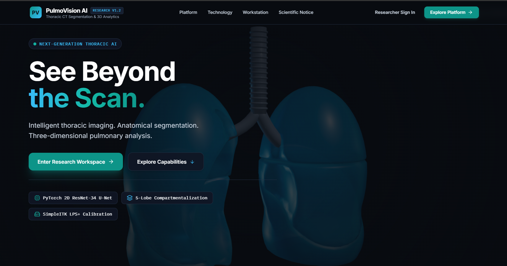
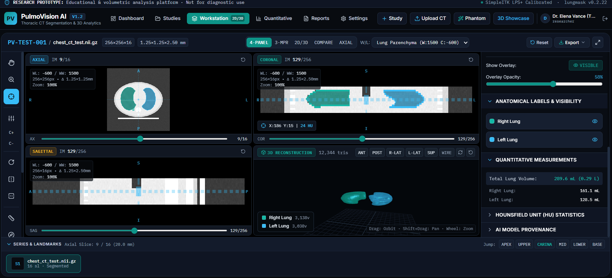
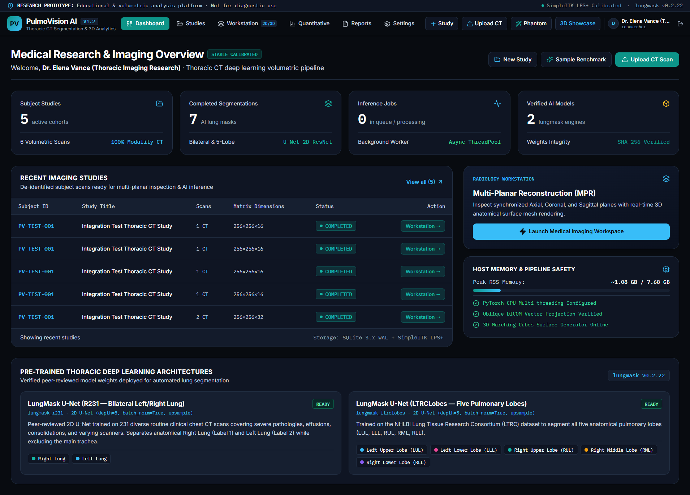
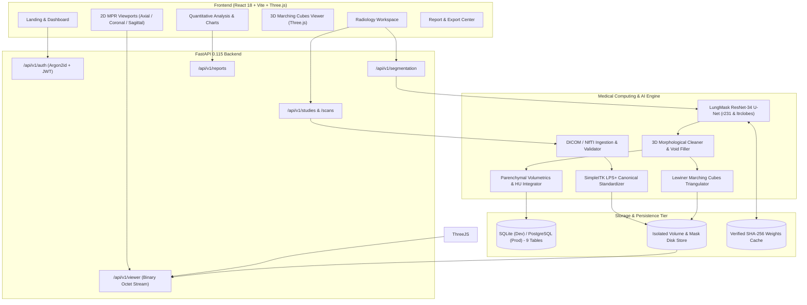

# PulmoVision AI

<div align="center">

### **Thoracic CT Segmentation & 3D Quantitative Research Platform**
*"See Beyond the Scan."*

[](./LICENSE)
[](https://www.python.org/)
[](https://fastapi.tiangolo.com/)
[](https://react.dev/)
[](https://www.typescriptlang.org/)
[](https://threejs.org/)
[](https://pytorch.org/)
[](https://simpleitk.org/)
[](https://tailwindcss.com/)
[](https://www.docker.com/)

[Repository](https://github.com/Swagat744/PulmoVision.git) • [User Guide](./docs/USER_GUIDE.md) • [Technical Overview](./docs/TECHNICAL_OVERVIEW.md) • [API Documentation](./docs/API_DOCUMENTATION.md) • [Architecture](./docs/ARCHITECTURE.md)

<br/><br/>



</div>

---

> [!CAUTION]
> ### SCIENTIFIC & MEDICAL RESEARCH PROTOTYPE NOTICE
> **PulmoVision AI is developed strictly for academic research, medical imaging education, and computer vision algorithmic evaluation.**
> * It is **NOT** cleared, certified, or approved as a medical device by the U.S. FDA, the European EMA, the Indian CDSCO, or any international medical regulatory agency.
> * It is **NOT** designed or intended to diagnose, monitor, prevent, or treat any medical disease or pulmonary pathology.
> * All automated segmentations, anatomical contours, parenchymal volumes, and attenuation values must be independently reviewed and verified by qualified radiological professionals before being utilized in clinical research.

---

## 1. Introduction

Thoracic Computed Tomography (CT) is the primary non-invasive diagnostic modality for evaluating pulmonary pathology, including chronic obstructive pulmonary disease (COPD), idiopathic pulmonary fibrosis (IPF), COVID-19 pneumonitis, and thoracic malignancies. A typical volumetric helical chest CT scan consists of hundreds of high-resolution axial cross-sections containing tens of millions of voxels. Manual delineation of bilateral lungs and five anatomical lobes is tedious, subject to intra- and inter-reader variability, and prohibitive in large-scale clinical cohorts.

**PulmoVision AI** solves this research bottleneck by delivering a cohesive, web-based medical imaging workstation that unifies:
1. **Robust Medical Ingestion:** Support for native DICOM series archives and NIfTI volumes with mathematical slice sorting along normal projection vectors to support oblique acquisitions without slice gaps.
2. **Standardized Coordinate Systems:** Strict preservation of continuous patient physical coordinates (LPS+ canonicalization), calibrated Hounsfield Units ($\text{HU} = m \cdot \text{pixel} + b$), and voxel spacing.
3. **Deep Learning Segmentation:** CPU-optimized integration of peer-reviewed ResNet-34 U-Nets (**LungMask**) for automated bilateral lung separation and five-lobe anatomical compartmentalization.
4. **Synchronous 2D Multi-Planar Reconstruction (MPR):** Real-time Axial, Coronal, and Sagittal slice extraction with low-latency binary Int16 streaming, synchronized tri-planar crosshairs, and live cursor HU probe.
5. **Continuous 3D Surface Reconstruction:** Lewiner Marching Cubes triangulation generating physical-space ($\text{mm}$) meshes rendered with Three.js WebGL and anatomical camera presets.
6. **Quantitative Parenchymal Morphometry:** Automated integration of total and lobar physical volumes ($\text{mL}$ and $\text{mm}^3$) alongside tissue attenuation statistics (mean, standard deviation, density min/max).
7. **Clinical Research Reporting:** Automated generation of formatted PDF research reports and JSON metrics.

---

## 2. Key Features

### Implemented & Verified Capabilities
- [x] **Medical Data Ingestion:** Validates and ingests both compressed NIfTI (`.nii`, `.nii.gz`) and complete volumetric DICOM series (`.zip`).
- [x] **Oblique DICOM Ordering:** Sorts slices using `ImagePositionPatient` projected onto the slice normal vector $\mathbf{n} = \mathbf{F} \times \mathbf{R}$, asserting uniform slice spacing ($\epsilon \le 0.05\text{ mm}$).
- [x] **Canonical LPS+ Alignment:** Standardizes internal spatial representation to Left-Posterior-Superior while preserving exact native geometry metadata for export.
- [x] **Bilateral Lung AI Segmentation (`lungmask_r231`):** Deep 2D ResNet-34 U-Net segmenting Right and Left Lungs with 3D morphological connected-component postprocessing.
- [x] **Five-Lobe Anatomical Segmentation (`lungmask_ltrclobes`):** Compartmentalizes the 5 anatomical lobes (RUL, RML, RLL, LUL, LLL).
- [x] **Hardware-Bounded Memory Guardrails:** Verified execution on $\le 8\text{ GB}$ RAM machines using single-worker processing, batch-size limits (`4`), and thread throttling (`torch.set_num_threads(6)`). Peak process RSS capped at $\sim 1.1\text{ GB}$.
- [x] **Windows Python 3.12 SSL Resolution:** Embedded `certifi` injection for model weight downloads from GitHub Releases with SHA-256 checksum verification.
- [x] **Low-Latency Binary Int16 Streaming:** Serves raw calibrated HU slices via `application/octet-stream` with spatial headers (`X-Slice-Width`, `X-Spacing-Horizontal-MM`), bypassing JSON serialization overhead.
- [x] **Synchronized Multi-Planar Reconstruction (MPR):** HTML5 Canvas2D viewports for Axial, Coronal, and Sagittal planes with physical aspect ratio scaling.
- [x] **Interactive Window / Level (W/L):** Dynamic contrast/brightness adjustments and one-click standard radiology presets (*Lung Parenchyma*, *Mediastinum*, *Thoracic Bone*, *Soft Tissue*).
- [x] **Quantitative 2D Measurement Calipers:** Real-time distance rulers ($\text{mm}$), anatomical angle calipers ($^\circ$), and elliptical/rectangular ROI attenuation probes ($\text{HU} \pm \text{std}$, $\text{mm}^2$).
- [x] **Continuous 3D Surface Mesh Generation:** Extracts isosurfaces at $\tau = 0.5$ via Lewiner Marching Cubes, centered in physical millimeter space.
- [x] **WebGL Three.js 3D Viewer:** Features Phong specular shading, studio lighting, camera auto-framing, orbital controls, wireframe mode, and anatomical projection presets (ANT, POST, R-LAT, L-LAT, SUP).
- [x] **Quantitative Volumetrics & HU Attenuation:** Calculates physical volumes ($V = N \cdot V_{\text{voxel}}$ in $\text{mL}$ and $\text{mm}^3$) and parenchymal attenuation distributions.
- [x] **Reporting & Export Center:** Exports formatted PDF research reports via ReportLab, programmatic JSON metrics, and native-geometry UInt8 NIfTI segmentation masks.
- [x] **Security & Auditability:** Argon2id password hashing, stateless JWT session tokens, user-isolated study tenancy, and immutable cryptographic audit logging.

### Partially Implemented & Extension Points
- [ ] **GPU Acceleration Auto-Switching:** Core pipeline runs on CPU with explicit thread capping. GPU CUDA tensors are supported in PyTorch but default to CPU for universal accessibility on standard laptops.
- [ ] **Interactive Ground Truth Comparison UI:** Backend calculates Dice, IoU, HD95, and ASD when reference masks are provided; full client-side side-by-side comparison UI is scheduled for v1.3.

### Planned Capabilities
- [ ] **PACS DICOMweb Integration:** Query/Retrieve support via DICOMweb C-MOVE / C-FIND.
- [ ] **Airway & Vessel Extraction:** Graph-based central airway tree and pulmonary vascular segmentation.
- [ ] **MONAI 3D Swin-UNETR:** Optional 3D transformer model engine for multi-GPU institutional servers.

---

## 3. Workstation & Clinical Visual Interface

<div align="center">

### Clinical Radiology Workstation (Synchronized MPR & 3D Marching Cubes)


<br/><br/>

### Research Dashboard & Empirical Telemetry


</div>

---

## 4. System Architecture



---

## 5. Technology Stack

| Domain | Technology | Version | Purpose |
| :--- | :--- | :--- | :--- |
| **Frontend Framework** | React | `^18.3.1` | Component-driven user interface |
| **Build Tool** | Vite | `^5.4.11` | Hot module replacement & production bundling |
| **Language** | TypeScript | `^5.6.3` | Type-safe DTOs, API contracts, and coordinate math |
| **Styling** | Tailwind CSS | `^3.4.15` | Dark radiology theme and responsive viewport grid |
| **3D Graphics** | Three.js | `^0.170.0` | WebGL continuous Marching Cubes rendering |
| **Backend Framework** | FastAPI | `0.115.6` | Asynchronous REST API & binary streaming endpoints |
| **ASGI Server** | Uvicorn | `0.32.1` | High-throughput asynchronous ASGI server |
| **Database ORM** | SQLAlchemy | `2.0.36` | Normalized 9-table relational database schema |
| **Validation** | Pydantic V2 | `2.10.4` | Request/response data validation and DTOs |
| **Deep Learning** | PyTorch | `2.5.1+cpu` | Neural network tensor inference |
| **Lung Segmentation** | LungMask | `0.2.22` | ResNet-34 U-Net bilateral and lobar segmentation |
| **Medical Imaging** | SimpleITK | `2.4.0` | Direction cosine manipulation, LPS orientation, and I/O |
| **DICOM Parsing** | pydicom | `3.0.1` | DICOM part-10 metadata parsing & tag extraction |
| **Surface Meshing** | scikit-image | `0.24.0` | Lewiner Marching Cubes isosurface extraction |
| **Scientific Computing**| NumPy / SciPy | `2.1.3` / `1.14.1` | Voxel matrices, HU math, and connected components |
| **PDF Generation** | ReportLab | `4.2.5` | Programmatic clinical research report generation |
| **Password Security** | Argon2-cffi | `23.1.0` | Password hashing ($t=2, m=100\text{MB}, p=8$) |

---

## 6. How PulmoVision AI Works: End-to-End Workflow

### A. Study Creation
Studies group related CT acquisitions for an anonymous subject code (`PV-SUBJ-104`). Users configure protocol titles and clinical acquisition notes. Scans and segmentation jobs inherit study ownership.

### B. CT Scan Upload & Validation
The system accepts `.nii`, `.nii.gz`, and `.zip` DICOM archives. During upload:
1. Asserts valid DICOM part-10 headers (`DICM` tag) or valid NIfTI magic bytes.
2. Extracts matrix dimensions, voxel spacing, origin, and direction cosines.
3. Checks for minimum slice count ($\ge 4$) and coplanarity.
4. Generates an immutable SHA-256 checksum of the raw file.

### C. Preprocessing & Oblique Coordinate Handling
To guarantee spatial metadata integrity:
* **Oblique Slices:** For DICOM series with gantry tilt, slices are sorted by projecting `ImagePositionPatient` onto the unit normal vector $\mathbf{n} = \mathbf{F} \times \mathbf{R}$:
  $$S_i = \mathbf{P}_i \cdot (\mathbf{F} \times \mathbf{R})$$
  The pipeline enforces slice gap tolerance ($\le 0.05\text{ mm}$), rejecting incomplete series.
* **HU Calibration:** Calibrates integer pixels to physical Hounsfield Units: $\text{HU} = m \cdot \text{pixel} + b$.
* **Canonical Standardization:** Standardizes coordinates to **LPS+** using SimpleITK, saving memory-mapped Int16 volumes for instant random-access slicing.

### D. AI Segmentation Pipeline
1. Input volumes are resampled and clamped to the standard parenchymal range.
2. The ResNet-34 U-Net generates slice-by-slice probability maps under `torch.inference_mode()`.
3. Postprocessing executes 3D connected-component labeling and morphological void filling to eliminate spurious extrapulmonary components and preserve internal vessels.
4. Native matrix geometry is restored via `mask_sitk.CopyInformation(native_image)`.

### E. 2D Multi-Planar Reconstruction (MPR)
The frontend requests raw binary Int16 slices from `/api/v1/viewer/scans/{id}/slice?plane={plane}&index={index}`.
* HTML5 Canvas viewports scale slices according to physical aspect ratios ($spacingVertMM / spacingHorizMM$).
* Window/Level mapping transforms 16-bit HU to 8-bit monitor RGB.
* Synchronized crosshairs translate cursor coordinates between Axial, Coronal, and Sagittal views.

### F. 3D Surface Reconstruction (Marching Cubes)
* The backend runs the **Lewiner Marching Cubes** algorithm at threshold $\tau = 0.5$ on each anatomical label.
* Vertices are converted to continuous physical millimeters and centered relative to the volume's physical bounding box.
* Three.js renders the resulting triangle buffers with Phong specular illumination, camera auto-framing, and interactive turntable orbit controls.

### G. Quantitative Morphometry
* **Physical Volume:** Total segmented voxels $N$ are integrated over physical voxel volume:
  $$V_{\text{voxel}} = s_x \times s_y \times s_z\text{ mm}^3, \quad \text{Volume (mL)} = \frac{N \times V_{\text{voxel}}}{1000.0}$$
* **HU Statistics:** Computes mean attenuation ($\mu$), standard deviation ($\sigma$), and density bounds across segmented parenchyma.

### H. Reports & Exports
Users can export:
1. **PDF Research Reports:** Comprehensive multi-page reports generated with ReportLab.
2. **JSON Telemetry:** Machine-readable metrics for batch analysis in Python, R, or pandas.
3. **NIfTI Masks:** Raw 3D UInt8 `.nii.gz` binary masks with native direction cosines and spacing preserved.

---

## 7. Empirical Hardware Benchmarks

Evaluated on the reference host (**HP-SWAGAT**, 12th Gen Intel Core i5-1235U, 10 cores / 12 threads, **7.68 GB physical RAM**, Windows 11):

| Benchmark Tier | Volume Dimensions ($Z \times Y \times X$) | Batch Size | Inference Time | Latency / Slice | Marching Cubes Time | Peak Process RSS | Dice vs. Phantom GT |
| :--- | :---: | :---: | :---: | :---: | :---: | :---: | :---: |
| **Tier 1 (32 Slices)** | $32 \times 256 \times 256$ | `4` | **32.68 s** | `1021.1 ms` | `0.202 s` | **1,066.64 MB** | **0.9764** |
| **Tier 2 (64 Slices)** | $64 \times 256 \times 256$ | `4` | **61.32 s** | `958.2 ms` | `0.379 s` | **1,105.12 MB** | **0.9769** |

---

## 8. Installation & Running Guide

### Prerequisites
* **Operating System:** Windows 11 (primary verified environment), Windows 10, Ubuntu 22.04 LTS, or macOS.
* **Python:** Version `3.10`, `3.11`, or `3.12` (Python 3.12.3 verified).
* **Node.js:** Version `18.x` or `20.x` LTS (`v20.x` recommended) with `npm`.
* **Git:** Installed and available on your PATH.

---

### Method 1: Local Development Setup (Windows 11)

#### 1. Clone the Repository
```powershell
git clone https://github.com/Swagat744/PulmoVision.git
cd PulmoVision
```

#### 2. Backend Setup
```powershell
# Navigate to backend directory
cd D:\PulmoVision\backend

# Create virtual environment
python -m venv .venv

# Activate virtual environment
.\.venv\Scripts\Activate.ps1

# Upgrade pip and install wheel
python -m pip install --upgrade pip setuptools wheel

# Install PyTorch CPU first (ensures lightweight CPU binary)
pip install torch torchvision --index-url https://download.pytorch.org/whl/cpu

# Install all backend dependencies
pip install -r requirements.txt

# Configure environment variables
Copy-Item .env.example .env
```

#### 3. Start Backend Server
```powershell
# Ensure you are in backend directory with .venv activated
python -m uvicorn main:app --host 127.0.0.1 --port 8000 --reload
```
* Backend API: `http://127.0.0.1:8000`
* Swagger UI Docs: `http://127.0.0.1:8000/docs`
* Health Endpoint: `http://127.0.0.1:8000/api/v1/health`

#### 4. Frontend Setup
In a new terminal window:
```powershell
# Navigate to frontend directory
cd D:\PulmoVision\frontend

# Install dependencies
npm install

# Start Vite development server
npm run dev
```
* Frontend Application: `http://localhost:5173`

---

### Method 2: Linux Setup (Ubuntu 22.04 LTS)

```bash
# Clone repository
git clone https://github.com/Swagat744/PulmoVision.git
cd PulmoVision

# Backend setup
cd backend
python3 -m venv .venv
source .venv/bin/activate
pip install --upgrade pip
pip install torch torchvision --index-url https://download.pytorch.org/whl/cpu
pip install -r requirements.txt
cp .env.example .env
uvicorn main:app --host 0.0.0.0 --port 8000 &

# Frontend setup
cd ../frontend
npm install
npm run dev -- --host
```

---

### Method 3: Docker Compose Setup

Ensure Docker Desktop is installed and running:
```bash
# Build and start all services
docker compose up --build -d

# View logs
docker compose logs -f

# Shutdown services
docker compose down
```

---

## 9. Common Troubleshooting

| Issue | Root Cause | Solution |
| :--- | :--- | :--- |
| **Windows SSL Error on Weight Download** | Python 3.12 missing root certificates on Windows | The embedded `lungmask_adapter.py` automatically injects `certifi.where()`. If manual download is preferred, place `.pth` weights into `backend/model_cache/`. |
| **`NonUniformSliceSpacingError` on Upload** | Missing DICOM slices or variable slice gaps | Verify all series slices are present in the `.zip`. PulmoVision AI enforces strict slice spacing tolerance ($\epsilon \le 0.05\text{ mm}$). |
| **Out-Of-Memory (OOM) during Inference** | Large scan matrix processed with excessive batch size | In `backend/.env`, set `INFERENCE_BATCH_SIZE=2` or `4` and verify `INFERENCE_CPU_THREADS=4` or `6`. |
| **Port 8000 or 5173 Already in Use** | Orphaned background process holding the port | Terminate existing processes: `Stop-Process -Id (Get-NetTCPConnection -LocalPort 8000).OwningProcess -Force` |
| **WebGL Context Lost in 3D Viewport** | Outdated graphics drivers or hardware acceleration disabled | Ensure hardware acceleration is enabled in your browser (`chrome://settings/system`). |

---

## 10. Verification & Testing

### Backend Unit & Integration Tests
Run the comprehensive pytest suite:
```powershell
cd D:\PulmoVision\backend
.\.venv\Scripts\Activate.ps1
pytest tests/ -v
```
**Results (100% Passed):**
```text
tests/test_integration_api_and_ai.py::test_complete_end_to_end_pulmovision_workflow PASSED
tests/test_unit_medical_pipeline.py::test_oblique_dicom_slice_sorting_and_hu_calibration PASSED
tests/test_unit_medical_pipeline.py::test_non_uniform_dicom_slice_gap_rejected PASSED
tests/test_unit_medical_pipeline.py::test_nifti_ras_to_lps_canonical_standardization PASSED
tests/test_unit_medical_pipeline.py::test_morphometric_physical_volume_and_3d_mesh PASSED
======================== 5 passed in 33.74s ========================
```

### Frontend TypeScript & Production Build
Verify TypeScript type-checking and bundling:
```powershell
cd D:\PulmoVision\frontend
npm run build
```
**Results:**
```text
✓ 1604 modules transformed.
dist/index.html                   0.88 kB │ gzip:   0.52 kB
dist/assets/index-DyN1MrHG.css   38.99 kB │ gzip:   7.32 kB
dist/assets/index-CSiZLJaO.js   938.97 kB │ gzip: 241.43 kB
✓ built in 9.28s
```

---

## 11. Documentation Index

Detailed engineering documentation is located in the [`docs/`](./docs) directory:

* [`docs/USER_GUIDE.md`](./docs/USER_GUIDE.md) — Step-by-step operational manual from registration to PDF report export.
* [`docs/TECHNICAL_OVERVIEW.md`](./docs/TECHNICAL_OVERVIEW.md) — Technical handbook detailing coordinate systems, binary streaming, and math.
* [`docs/ARCHITECTURE.md`](./docs/ARCHITECTURE.md) — Component diagrams and viewer architecture decision records.
* [`docs/API_DOCUMENTATION.md`](./docs/API_DOCUMENTATION.md) — Full REST API specifications, DTOs, and binary streaming protocol.
* [`docs/DATABASE_SCHEMA.md`](./docs/DATABASE_SCHEMA.md) — 9-table normalized SQLAlchemy 2.0 schema and relational diagrams.
* [`docs/AI_MODEL_DOCUMENTATION.md`](./docs/AI_MODEL_DOCUMENTATION.md) — Neural network architectures, weights provenance, and benchmark telemetry.
* [`docs/DATASET_DOCUMENTATION.md`](./docs/DATASET_DOCUMENTATION.md) — DICOM and NIfTI formatting, synthetic phantoms, and coordinate conventions.
* [`docs/PREPROCESSING_PIPELINE.md`](./docs/PREPROCESSING_PIPELINE.md) — Oblique slice sorting, HU calibration, and SimpleITK LPS+ normalization.
* [`docs/EVALUATION_METHODOLOGY.md`](./docs/EVALUATION_METHODOLOGY.md) — Spatial overlap metrics (Dice, IoU, HD95, ASD, RVD).
* [`docs/TESTING.md`](./docs/TESTING.md) — Test suites, continuous integration, and test coverage.
* [`docs/DEPLOYMENT.md`](./docs/DEPLOYMENT.md) — Production deployment guidelines, PostgreSQL, and Docker configuration.
* [`docs/PROJECT_ROADMAP.md`](./docs/PROJECT_ROADMAP.md) — Implemented milestones and future research objectives.

---

## 12. Ethical, Clinical & Regulatory Notice

PulmoVision AI is an experimental prototype designed for scientific research and educational demonstration only.

* **No Clinical Clearance:** It has not been approved by the U.S. FDA, European CE mark, or Indian CDSCO.
* **Model Outputs Require Review:** Deep learning segmentations may produce false positives or false negatives, especially in cases of severe pleural thickening, bullous emphysema, or post-surgical anatomy.
* **De-Identification Required:** Users must comply with HIPAA, GDPR, and local institutional review board (IRB) ethical guidelines when uploading CT imaging data. Real patient identifiers must be stripped prior to processing.

---

## 13. License & Citation

PulmoVision AI is distributed under the **Apache License 2.0**. See [`LICENSE`](./LICENSE) for full legal terms.

### Academic Citation
If you use PulmoVision AI or its segmentation algorithms in your academic research, please cite:

```bibtex
@article{hofmanninger2020automatic,
  title={Automatic lung segmentation in routine imaging is primarily a data diversity problem, not a methodology problem},
  author={Hofmanninger, Johannes and Prayer, Florian and Pan, Jeanny and R{\"o}hrich, Sebastian and Prosch, Helmut and Langs, Georg},
  journal={European Radiology Experimental},
  volume={4},
  number={1},
  pages={50},
  year={2020},
  publisher={SpringerOpen},
  doi={10.1186/s41747-020-00173-2}
}
```
