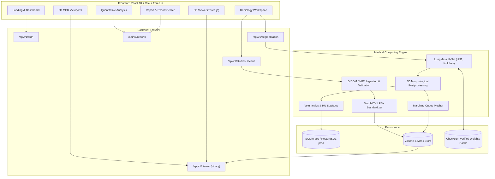

<div align="center">

# PulmoVision AI

### Thoracic CT Segmentation & 3D Quantitative Research Platform

*See beyond the scan.*

[](./LICENSE)
[](https://www.python.org/)
[](https://fastapi.tiangolo.com/)
[](https://react.dev/)
[](https://www.typescriptlang.org/)
[](https://threejs.org/)
[](https://pytorch.org/)
[](https://www.docker.com/)
[](#12-ethical-clinical-and-regulatory-notice)

[Repository](https://github.com/Swagat744/PulmoVision) ·
[User Guide](./docs/USER_GUIDE.md) ·
[Architecture](./docs/ARCHITECTURE.md) ·
[API Reference](./docs/API_DOCUMENTATION.md) ·
[Technical Overview](./docs/TECHNICAL_OVERVIEW.md)

<br/>


</div>

> [!CAUTION]
> **Research prototype. Not a medical device.**
> PulmoVision AI is built for academic research, medical imaging education and algorithm evaluation. It is **not** cleared or approved by the U.S. FDA, any CE-marking process, India's CDSCO, or any other regulator, and it is **not** intended to diagnose, monitor, prevent or treat any condition. Every automated contour, volume and attenuation value must be reviewed by a qualified professional before any research use.

---

## Table of Contents

1. [Introduction](#1-introduction)
2. [Key Features](#2-key-features)
3. [Application Preview](#3-application-preview)
4. [System Architecture](#4-system-architecture)
5. [Technology Stack](#5-technology-stack)
6. [End-to-End Workflow](#6-end-to-end-workflow)
7. [Performance Benchmarks](#7-performance-benchmarks)
8. [Installation](#8-installation)
9. [Troubleshooting](#9-troubleshooting)
10. [Testing and Verification](#10-testing-and-verification)
11. [Documentation Index](#11-documentation-index)
12. [Ethical, Clinical and Regulatory Notice](#12-ethical-clinical-and-regulatory-notice)
13. [Known Limitations](#13-known-limitations)
14. [License, Third-Party Components and Citation](#14-license-third-party-components-and-citation)

---

## 1. Introduction

Thoracic computed tomography (CT) is a primary imaging modality for evaluating pulmonary conditions such as COPD, pulmonary fibrosis, pneumonitis and thoracic malignancy. A single helical chest CT holds hundreds of axial slices and tens of millions of voxels. Manually delineating both lungs and the five anatomical lobes is slow, varies between readers, and does not scale to large cohorts.

**PulmoVision AI** is a web-based imaging workstation that brings the whole research workflow into one application:

| Capability | Description |
| :--- | :--- |
| **Medical data ingestion** | Native DICOM series archives (`.zip`) and NIfTI volumes (`.nii`, `.nii.gz`) with validation. |
| **Geometry preservation** | Canonical LPS+ orientation, calibrated Hounsfield Units (HU = m·pixel + b), exact voxel spacing and direction cosines. |
| **Deep learning segmentation** | CPU-friendly integration of [LungMask](https://github.com/JoHof/lungmask) U-Nets for left/right lung and five-lobe segmentation. |
| **Multi-planar reconstruction** | Synchronized axial, coronal and sagittal views with low-latency binary slice streaming and a live HU probe. |
| **3D surface rendering** | Marching Cubes meshes in physical millimetres, rendered with Three.js. |
| **Quantitative morphometry** | Total and per-lobe volumes (mL, mm³) and attenuation statistics. |
| **Reporting** | PDF research reports, JSON metrics and NIfTI mask export. |

---

## 2. Key Features

### Implemented

**Data and preprocessing**
- Ingestion and validation of NIfTI and DICOM series, including DICOM part-10 header checks and a SHA-256 checksum of every upload.
- Oblique-acquisition support: slices are ordered by projecting `ImagePositionPatient` onto the slice normal **n** = **F** × **R**, with uniform spacing enforced (tolerance ≤ 0.05 mm).
- Canonical **LPS+** internal representation, with native geometry preserved for export.

**AI segmentation**
- `lungmask_r231`: right and left lung, with 3D connected-component and void-filling postprocessing.
- `lungmask_ltrclobes`: five lobes (RUL, RML, RLL, LUL, LLL).
- Memory guardrails for 8 GB machines: single worker, batch size 4, capped CPU threads (peak process RSS about 1.1 GB in our benchmarks).
- Verified model-weight download (embedded `certifi` for Windows / Python 3.12, SHA-256 checksum check).

**Viewer**
- Binary Int16 slice streaming (`application/octet-stream`) with spatial headers such as `X-Slice-Width` and `X-Spacing-Horizontal-MM`.
- Synchronized tri-planar MPR with physical aspect-ratio scaling and crosshairs.
- Window/level control with presets: *Lung*, *Mediastinum*, *Bone*, *Soft Tissue*.
- Measurement tools: distance (mm), angle (°), elliptical and rectangular ROI statistics (mean ± SD HU, area).
- Three.js 3D viewer: Phong shading, auto-framing, orbit controls, wireframe mode and anatomical presets (ANT, POST, R-LAT, L-LAT, SUP).

**Quantification and export**
- Physical volume: `V (mL) = N × (sx · sy · sz) / 1000`, plus mean, standard deviation, minimum and maximum HU.
- ReportLab PDF reports, JSON metrics and UInt8 NIfTI masks in native geometry.

**Security and auditability**
- Argon2id password hashing, stateless JWT sessions, per-user study isolation, and cryptographically chained audit logging.

### In progress

| Item | Status |
| :--- | :--- |
| GPU auto-switching | PyTorch CUDA is supported; the default is CPU for portability. |
| Ground-truth comparison UI | Backend computes Dice, IoU, HD95 and ASD when a reference mask is supplied; side-by-side UI is planned for v1.3. |

### Roadmap

- [ ] DICOMweb integration (QIDO-RS / WADO-RS)
- [ ] Airway and pulmonary vessel extraction
- [ ] Optional MONAI 3D Swin UNETR engine for multi-GPU servers

---

## 3. Application Preview

<div align="center">

**Research dashboard**


*Study management, segmentation activity and analysis review.*

<br/>

**Imaging workstation**


*Synchronized MPR, segmentation overlays and 3D reconstruction.*

</div>

---

## 4. System Architecture



---

## 5. Technology Stack

| Layer | Technology | Version | Role |
| :--- | :--- | :--- | :--- |
| Frontend | React | `^18.3.1` | Component-based UI |
| Build | Vite | `^5.4.11` | Dev server and production bundling |
| Language | TypeScript | `^5.6.3` | Typed API contracts and coordinate math |
| Styling | Tailwind CSS | `^3.4.15` | Dark radiology theme, responsive layout |
| 3D | Three.js | `^0.170.0` | WebGL mesh rendering |
| Backend | FastAPI | `0.115.6` | REST API and binary streaming |
| Server | Uvicorn | `0.32.1` | ASGI server |
| ORM | SQLAlchemy | `2.0.36` | Nine-table relational schema |
| Validation | Pydantic | `2.10.4` | Request/response models |
| Deep learning | PyTorch | `2.5.1+cpu` | Inference |
| Segmentation | LungMask | `0.2.22` | Lung and lobe U-Nets |
| Imaging | SimpleITK | `2.4.0` | I/O, orientation, direction cosines |
| DICOM | pydicom | `3.0.1` | Metadata parsing |
| Meshing | scikit-image | `0.24.0` | Lewiner Marching Cubes |
| Numerics | NumPy / SciPy | `2.1.3` / `1.14.1` | Voxel math, connected components |
| Reports | ReportLab | `4.2.5` | PDF generation |
| Auth | Argon2-cffi | `23.1.0` | Password hashing |

---

## 6. End-to-End Workflow

```text
Create study → Upload & validate → Standardize (HU, LPS+) → Segment → Review (MPR + 3D) → Quantify → Export
```

1. **Study creation.** Studies group acquisitions under an anonymous subject code (for example `PV-SUBJ-104`). Scans and jobs inherit study ownership.
2. **Upload and validation.** The server checks DICOM `DICM` headers or NIfTI magic bytes, extracts dimensions, spacing, origin and direction, requires at least 4 coplanar slices, and stores a SHA-256 checksum.
3. **Preprocessing.** Slices are ordered along the normal vector, integer pixels are converted to HU, and the volume is standardized to LPS+ and saved as a memory-mapped Int16 array for fast random access.
4. **Segmentation.** Slice-wise probability maps are produced under `torch.inference_mode()`, then 3D connected-component labelling and void filling remove extrapulmonary fragments while keeping internal vessels. Native geometry is restored with `CopyInformation`.
5. **2D review.** The viewer requests raw slices from `/api/v1/viewer/scans/{id}/slice?plane={plane}&index={index}`, applies window/level in the browser and keeps the three planes synchronized.
6. **3D reconstruction.** Marching Cubes runs per anatomical label at an iso-level of 0.5, and vertices are placed in physical millimetres.
7. **Quantification.** Volumes and HU statistics are computed from the label maps and voxel spacing.
8. **Export.** PDF report, JSON metrics, or NIfTI masks.

---

## 7. Performance Benchmarks

Reference host: 12th Gen Intel Core i5-1235U (10 cores / 12 threads), 7.68 GB RAM, Windows 11, CPU-only inference.

| Tier | Volume (Z × Y × X) | Batch | Inference | Per slice | Mesh | Peak RSS | Dice vs. phantom |
| :--- | :---: | :---: | :---: | :---: | :---: | :---: | :---: |
| 1 | 32 × 256 × 256 | 4 | 32.68 s | 1021 ms | 0.20 s | 1,067 MB | 0.9764 |
| 2 | 64 × 256 × 256 | 4 | 61.32 s | 958 ms | 0.38 s | 1,105 MB | 0.9769 |

> [!NOTE]
> Dice values are measured against **synthetic phantom** ground truth. They verify the pipeline's geometry and plumbing; they are **not** a clinical accuracy claim and should not be compared with published results on patient data. See [Known Limitations](#13-known-limitations).

---

## 8. Installation

### Prerequisites

| Requirement | Version |
| :--- | :--- |
| OS | Windows 10/11, Ubuntu 22.04+, or macOS |
| Python | 3.10, 3.11 or 3.12 |
| Node.js | 18 or 20 LTS (20 recommended) |
| Git | any recent version |

### Option A: Local development on Windows (PowerShell)

```powershell
git clone https://github.com/Swagat744/PulmoVision.git
cd PulmoVision\backend

python -m venv .venv
.\.venv\Scripts\Activate.ps1
python -m pip install --upgrade pip setuptools wheel

# Install the CPU build of PyTorch first
pip install torch torchvision --index-url https://download.pytorch.org/whl/cpu
pip install -r requirements.txt
Copy-Item .env.example .env

python -m uvicorn main:app --host 127.0.0.1 --port 8000 --reload
```

In a second terminal:

```powershell
cd PulmoVision\frontend
npm install
npm run dev
```

| Service | URL |
| :--- | :--- |
| Frontend | http://localhost:5173 |
| API | http://127.0.0.1:8000 |
| Swagger UI | http://127.0.0.1:8000/docs |
| Health check | http://127.0.0.1:8000/api/v1/health |

### Option B: Linux / macOS

```bash
git clone https://github.com/Swagat744/PulmoVision.git
cd PulmoVision/backend

python3 -m venv .venv && source .venv/bin/activate
pip install --upgrade pip
pip install torch torchvision --index-url https://download.pytorch.org/whl/cpu
pip install -r requirements.txt
cp .env.example .env
uvicorn main:app --host 127.0.0.1 --port 8000 &

cd ../frontend
npm install
npm run dev
```

### Option C: Docker Compose

```bash
docker compose up --build -d   # build and start
docker compose logs -f         # follow logs
docker compose down            # stop
```

### Configuration

Copy `backend/.env.example` to `backend/.env`. Settings most often adjusted:

| Variable | Purpose | Suggested value |
| :--- | :--- | :--- |
| `INFERENCE_BATCH_SIZE` | Slices per forward pass; lower it to reduce memory | `2` to `4` |
| `INFERENCE_CPU_THREADS` | CPU threads used by PyTorch | `4` to `6` |

---

## 9. Troubleshooting

| Symptom | Likely cause | Resolution |
| :--- | :--- | :--- |
| SSL error while downloading weights (Windows) | Python 3.12 lacks root certificates | The adapter injects `certifi` automatically. Alternatively place the `.pth` files in `backend/model_cache/`. |
| `NonUniformSliceSpacingError` on upload | Missing slices or uneven gaps in the series | Confirm the whole series is in the `.zip`; spacing tolerance is 0.05 mm. |
| Out-of-memory during inference | Large volume or batch size too high | Set `INFERENCE_BATCH_SIZE=2` and `INFERENCE_CPU_THREADS=4` in `backend/.env`. |
| Port 8000 or 5173 already in use | Orphaned process | PowerShell: `Stop-Process -Id (Get-NetTCPConnection -LocalPort 8000).OwningProcess -Force` |
| WebGL context lost in the 3D view | Old graphics driver or hardware acceleration off | Update drivers and enable hardware acceleration in the browser. |

---

## 10. Testing and Verification

**Backend**

```bash
cd backend
pytest tests/ -v
```

```text
tests/test_integration_api_and_ai.py::test_complete_end_to_end_pulmovision_workflow PASSED
tests/test_unit_medical_pipeline.py::test_oblique_dicom_slice_sorting_and_hu_calibration PASSED
tests/test_unit_medical_pipeline.py::test_non_uniform_dicom_slice_gap_rejected PASSED
tests/test_unit_medical_pipeline.py::test_nifti_ras_to_lps_canonical_standardization PASSED
tests/test_unit_medical_pipeline.py::test_morphometric_physical_volume_and_3d_mesh PASSED
======================== 5 passed in 33.74s ========================
```

**Frontend**

```bash
cd frontend
npm run build
```

```text
✓ 1604 modules transformed.
dist/assets/index-*.js   938.97 kB │ gzip: 241.43 kB
✓ built in 9.28s
```

---

## 11. Documentation Index

| Document | Contents |
| :--- | :--- |
| [USER_GUIDE](./docs/USER_GUIDE.md) | Walkthrough from registration to report export |
| [TECHNICAL_OVERVIEW](./docs/TECHNICAL_OVERVIEW.md) | Coordinate systems, binary streaming, mathematics |
| [ARCHITECTURE](./docs/ARCHITECTURE.md) | Component diagrams and design decisions |
| [API_DOCUMENTATION](./docs/API_DOCUMENTATION.md) | REST endpoints, DTOs, binary streaming protocol |
| [DATABASE_SCHEMA](./docs/DATABASE_SCHEMA.md) | Nine-table schema and relationships |
| [AI_MODEL_DOCUMENTATION](./docs/AI_MODEL_DOCUMENTATION.md) | Architectures, weight provenance, benchmarks |
| [DATASET_DOCUMENTATION](./docs/DATASET_DOCUMENTATION.md) | DICOM/NIfTI formats, phantoms, conventions |
| [PREPROCESSING_PIPELINE](./docs/PREPROCESSING_PIPELINE.md) | Slice ordering, HU calibration, LPS+ normalization |
| [EVALUATION_METHODOLOGY](./docs/EVALUATION_METHODOLOGY.md) | Dice, IoU, HD95, ASD, RVD |
| [TESTING](./docs/TESTING.md) | Test suites and coverage |
| [DEPLOYMENT](./docs/DEPLOYMENT.md) | Production guidance, PostgreSQL, Docker |
| [PROJECT_ROADMAP](./docs/PROJECT_ROADMAP.md) | Milestones and future work |

---

## 12. Ethical, Clinical and Regulatory Notice

- **No regulatory clearance.** PulmoVision AI has not been reviewed or approved by the U.S. FDA, under EU MDR/CE marking, or by India's CDSCO.
- **Outputs require expert review.** Segmentations can contain false positives and false negatives, particularly with severe pleural thickening, bullous emphysema, large effusions or post-surgical anatomy.
- **Data protection.** Upload only de-identified data, and comply with applicable law and your institutional ethics approvals (for example HIPAA, GDPR, India's DPDP Act, and IRB or ethics committee requirements).
- **Not a diagnosis.** Nothing displayed by this software is a diagnosis or a treatment recommendation.

---

## 13. Known Limitations

- The bundled segmentation models are third-party (LungMask) and were **not** retrained or clinically validated by this project.
- Reported Dice scores use synthetic phantoms. Validation on independent, radiologist-annotated patient CT is still required before any performance claim.
- Lobe segmentation can degrade when fissures are poorly visible or disease is dense.
- Inference runs on CPU by default and takes roughly one second per slice on the reference laptop.
- Airway and vessel segmentation are not yet available.

---

## 14. License, Third-Party Components and Citation

PulmoVision AI is released under the **Apache License 2.0**; see [`LICENSE`](./LICENSE).

> [!IMPORTANT]
> **Third-party licenses.** LungMask is published under **GPL-3.0**. Because PulmoVision AI uses it, review license compatibility (and the licenses of all model weights and dependencies) before redistributing or commercializing this software.

### Citation

If you use PulmoVision AI or its segmentation models in academic work, please cite the LungMask paper:

```bibtex
@article{hofmanninger2020automatic,
  title     = {Automatic lung segmentation in routine imaging is primarily a data diversity problem, not a methodology problem},
  author    = {Hofmanninger, Johannes and Prayer, Florian and Pan, Jeanny and R{\"o}hrich, Sebastian and Prosch, Helmut and Langs, Georg},
  journal   = {European Radiology Experimental},
  volume    = {4},
  number    = {1},
  pages     = {50},
  year      = {2020},
  publisher = {SpringerOpen},
  doi       = {10.1186/s41747-020-00173-2}
}
```
