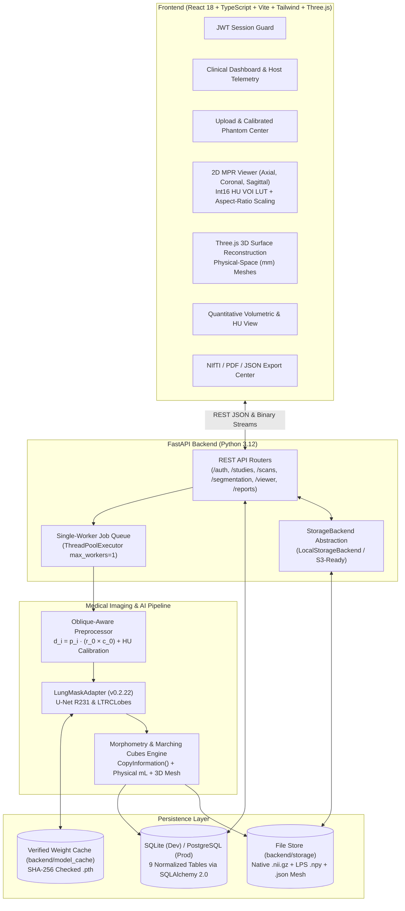

# PulmoVision AI — System Architecture (`ARCHITECTURE.md`)

## 1. Architectural Principles

1. **Spatial Metadata Integrity First:** Every CT scan retains both its **native acquisition geometry** (`Origin`, `Spacing`, $3 \times 3$ `Direction` cosine matrix) and a **canonical axis-aligned LPS+ representation** (`Left-Posterior-Superior`) for deterministic 2D Multi-Planar Reconstruction (MPR) and 3D surface extraction.
2. **Pluggable AI Model Adapter Pattern:** All segmentation engines implement `BaseSegmentationAdapter` (`backend/app/ml/adapters/base.py`), isolating model-specific preprocessing, PyTorch inference, and postprocessing from the FastAPI web layer.
3. **Memory-Bounded Execution on Constrained Hardware:** Verified on our target development host (`HP-SWAGAT`, Intel Core i5-1235U 10C/12T, **7.68 GB physical RAM**). Background inference runs inside a single-worker `ThreadPoolExecutor(max_workers=1)` with `INFERENCE_BATCH_SIZE=4` and `torch.set_num_threads(6)`, capping peak process RSS at **1,066–1,105 MB**.
4. **Precision Int16 HU Streaming vs. Heavy Client Texture Buffers:** Rather than allocating ~800 MB of browser WebGL textures (`SharedArrayBuffer`), the backend serves memory-mapped (`mmap_mode="r"`) binary `Int16Array` calibrated HU slices and `Uint8Array` mask slices with physical spacing headers, alongside pre-extracted physical-space ($\text{mm}$) 3D Marching Cubes meshes.

---

## 2. Component Architecture Diagram

---

## 3. Viewer Architecture Decision Record (Cornerstone3D vs. Custom Int16 HU Canvas2D MPR + Three.js)

* **Context:** The development machine has **7.68 GB total usable RAM** shared between Windows 11, the Python/PyTorch backend, and the web browser.
* **Evaluation:**
  * **Cornerstone3D:** Requires `SharedArrayBuffer` (`COOP`/`COEP` cross-origin isolation headers), complex Vite WebWorker/WASM bundling (`@icr/polyseg-wasm`), and allocates uncompressed 3D GPU/WebGL volume + labelmap textures (~650–900 MB browser RAM for a 300-slice scan).
  * **Precision Int16 HU Canvas2D MPR + Three.js 3D Mesh:** Streams raw binary `Int16Array` calibrated HU slices on demand (`< 80 MB` browser RAM), computes the exact DICOM linear VOI LUT in real time on typed arrays, applies physical spacing aspect-ratio scaling ($\Delta z / \Delta x$, $\Delta z / \Delta y$) on Coronal/Sagittal planes, and renders pre-extracted physical-space Marching Cubes surfaces in Three.js at 60 FPS.
* **Decision:** Adopted the Precision Int16 HU Canvas2D MPR + Three.js 3D Surface Viewer for deterministic performance on 8 GB hosts, while exporting standard NIfTI (`.nii.gz`) volumes compatible with any external DICOM/NIfTI workstation.

