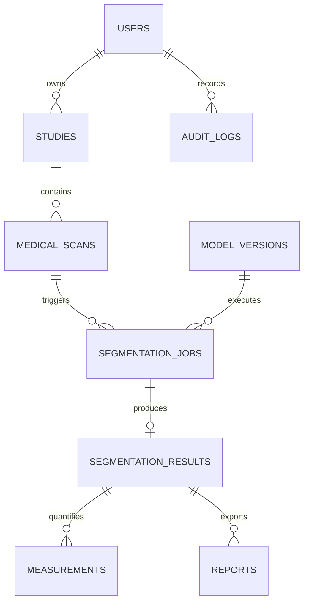

# PulmoVision AI — Normalized Database Schema (`DATABASE_SCHEMA.md`)

Implemented in `backend/app/models/entities.py` using SQLAlchemy 2.0 ORM (`Mapped` / `mapped_column`).
* **SQLite Development Mode:** Automatically executes `PRAGMA foreign_keys=ON` on every connection (`backend/app/db/session.py`) so foreign-key cascades and restrictions behave identically to PostgreSQL.
* **PostgreSQL Production Mode:** Configured via `DATABASE_URL=postgresql+psycopg2://...`.
* **Storage Rule:** Large 3D image binaries, masks, and meshes are stored on disk/object storage; only storage keys and SHA-256 digests are persisted in relational columns.

---

## 1. Entity-Relationship Diagram

---

## 2. Table Definitions

### 2.1 `users`
| Column | Type | Constraints | Description |
| :--- | :--- | :--- | :--- |
| `id` | `VARCHAR(36)` | `PK` | UUID v4 string |
| `email` | `VARCHAR(255)` | `UNIQUE, NOT NULL, INDEX` | Normalized lowercase email |
| `hashed_password` | `VARCHAR(255)` | `NOT NULL` | Argon2id password hash |
| `full_name` | `VARCHAR(150)` | `NOT NULL` | Researcher display name |
| `role` | `VARCHAR(32)` | `NOT NULL DEFAULT 'researcher'` | `researcher`, `clinician`, `admin` |
| `is_active` | `BOOLEAN` | `NOT NULL DEFAULT TRUE` | Account status |
| `created_at` | `TIMESTAMPTZ` | `NOT NULL` | Creation timestamp (UTC) |
| `updated_at` | `TIMESTAMPTZ` | `NOT NULL` | Last update timestamp (UTC) |

### 2.2 `studies`
| Column | Type | Constraints | Description |
| :--- | :--- | :--- | :--- |
| `id` | `VARCHAR(36)` | `PK` | UUID v4 |
| `user_id` | `VARCHAR(36)` | `FK -> users.id ON DELETE CASCADE` | Owner user ID |
| `study_code` | `VARCHAR(64)` | `UNIQUE, NOT NULL, INDEX` | Human-readable code (`PV-2026-XXXXXX`) |
| `patient_anon_id` | `VARCHAR(128)` | `NOT NULL` | De-identified subject identifier |
| `title` | `VARCHAR(255)` | `NOT NULL` | Study title |
| `clinical_notes` | `TEXT` | `NULLABLE` | Research protocol notes |
| `modality` | `VARCHAR(16)` | `NOT NULL DEFAULT 'CT'` | Imaging modality |
| `acquisition_date` | `DATE` | `NULLABLE` | Study acquisition date |
| `status` | `VARCHAR(32)` | `NOT NULL DEFAULT 'ACTIVE'` | Study lifecycle state |
| `created_at` | `TIMESTAMPTZ` | `NOT NULL` | UTC timestamp |
| `updated_at` | `TIMESTAMPTZ` | `NOT NULL` | UTC timestamp |

### 2.3 `medical_scans`
| Column | Type | Constraints | Description |
| :--- | :--- | :--- | :--- |
| `id` | `VARCHAR(36)` | `PK` | UUID v4 |
| `study_id` | `VARCHAR(36)` | `FK -> studies.id ON DELETE CASCADE` | Parent study |
| `original_filename` | `VARCHAR(255)` | `NOT NULL` | Uploaded filename |
| `file_format` | `VARCHAR(16)` | `NOT NULL` | `NIFTI`, `DICOM_ZIP`, `DICOM_SERIES` |
| `raw_storage_key` | `VARCHAR(512)` | `NOT NULL` | Native-geometry NIfTI path |
| `lps_cache_key` | `VARCHAR(512)` | `NOT NULL` | Canonical LPS+ Int16 `.npy` cache path |
| `file_sha256` | `VARCHAR(64)` | `NOT NULL` | Cryptographic SHA-256 digest |
| `file_size_bytes` | `BIGINT` | `NOT NULL` | Uploaded file size in bytes |
| `num_slices` | `INTEGER` | `NOT NULL` | Axial slice count ($Z$) |
| `dim_x`, `dim_y`, `dim_z` | `INTEGER` | `NOT NULL, CHECK (> 0)` | Voxel matrix dimensions |
| `spacing_x_mm`, `spacing_y_mm`, `spacing_z_mm` | `FLOAT` | `NOT NULL, CHECK (> 0)` | Physical voxel spacing in $\text{mm}$ |
| `native_origin_mm` | `JSON` | `NOT NULL` | `[ox, oy, oz]` in $\text{mm}$ |
| `native_direction` | `JSON` | `NOT NULL` | 9-float $3 \times 3$ direction cosine matrix |
| `native_orientation_code` | `VARCHAR(8)` | `NOT NULL` | ITK orientation string (e.g. `LPS`, `RAS`) |
| `lps_origin_mm` | `JSON` | `NOT NULL` | Canonical LPS+ origin |
| `hu_min`, `hu_max` | `FLOAT` | `NOT NULL` | Calibrated Hounsfield Unit range |
| `rescale_slope`, `rescale_intercept` | `FLOAT` | `NOT NULL` | DICOM HU linear calibration parameters |
| `is_oblique` | `BOOLEAN` | `NOT NULL DEFAULT FALSE` | True if gantry/acquisition is tilted |
| `validation_warnings` | `JSON` | `NOT NULL` | Non-fatal ingestion warnings |
| `uploaded_at` | `TIMESTAMPTZ` | `NOT NULL` | UTC timestamp |

### 2.4 `model_versions`
Stores verified AI model metadata (`model_key`, `display_name`, `architecture`, `package_version`, `task_type`, `num_classes`, `label_map`, `weights_url`, `weights_sha256`, `license_spdx`, `citation_doi`, `description`, `known_limitations`).

### 2.5 `segmentation_jobs`
Tracks asynchronous background inference (`id`, `scan_id`, `model_version_id`, `requested_by_user_id`, `status`, `current_stage`, `progress_percent`, `batch_size_used`, `device_used`, `execution_time_sec`, `peak_ram_mb`, `error_message`, `created_at`, `started_at`, `completed_at`).

### 2.6 `segmentation_results`
Stores completed segmentation outputs (`id`, `job_id UNIQUE FK`, `native_mask_key`, `lps_mask_cache_key`, `mesh_storage_key`, `mask_sha256`, `label_summary`, `geometry_verified`, `created_at`).

### 2.7 `measurements`
Stores geometry-aware physical volume and radiodensity metrics per anatomical label (`id`, `result_id FK`, `label_id`, `structure_key`, `display_name`, `color_hex`, `voxel_count`, `physical_volume_mm3`, `physical_volume_ml`, `volume_fraction_pct`, `mean_hu`, `std_hu`, `min_hu`, `max_hu`, `bbox_lps_voxel`, `computed_at`). Enforces `UNIQUE(result_id, label_id)`.

### 2.8 `reports` & 2.9 `audit_logs`
* `reports`: Tracks exported PDF and JSON research reports (`id`, `result_id FK`, `generated_by_user_id`, `report_format`, `storage_key`, `file_sha256`, `report_payload`, `created_at`).
* `audit_logs`: Immutable security and operational audit log (`id`, `user_id`, `action`, `resource_type`, `resource_id`, `details`, `ip_address`, `created_at`).

