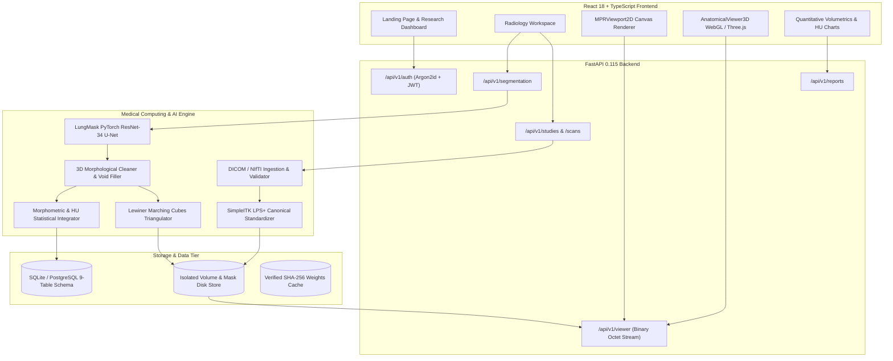

# PulmoVision AI — Technical Architecture & Engineering Handbook

## Abstract

**PulmoVision AI** is a full-stack medical imaging research workstation designed for automated volumetric chest CT segmentation, multi-planar reconstruction (MPR), continuous 3D anatomical surface mesh visualization, and quantitative parenchymal morphometry. This document serves as the comprehensive technical handbook for software engineers, medical imaging researchers, and clinical evaluators inspecting the codebase.

---

## 1. System Architecture Overview

PulmoVision AI is built as a modular client-server architecture decoupled across clean network boundaries:

---

## 2. Frontend Architecture & Component Topology

The client is developed in **React 18** with strict **TypeScript**, bundled using **Vite**, and styled with **Tailwind CSS**.

### Directory Structure (`frontend/src/`):
* `components/landing/`:
  * `LandingPage.tsx`: Public platform showcase with smooth scroll progress tracking.
  * `CinematicLungScene.tsx`: Interactive Three.js pulmonary model loading `lungs.glb` with dynamic mouse parallax, anatomical material shaders, and scroll-synced rotation.
  * `WorkstationShowcase.tsx`: Live demonstration embedding genuine `MPRViewport2D` and `AnatomicalViewer3D` viewports.
* `components/workspace/`:
  * `RadiologyWorkspace.tsx`: Main research workstation managing multi-viewport grids (4-panel, 3-MPR, split 2D/3D), crosshair state, W/L presets, tool selection, and measurement caching.
* `components/viewer/`:
  * `MPRViewport2D.tsx`: High-performance HTML5 Canvas viewport supporting raw binary Int16 streaming, physical millimeter aspect ratio preservation, synchronous crosshairs, and live HU probe.
* `components/viewer3d/`:
  * `AnatomicalViewer3D.tsx`: Interactive Three.js WebGL viewer rendering Marching Cubes surface meshes with double-sided Phong illumination, camera auto-centering, and anatomical orientation presets.
* `components/analysis/`:
  * `QuantitativeAnalysisView.tsx`: Volumetric distribution cards, lobar percentage charts, and attenuation histograms.
* `components/reports/`:
  * `ReportsExportView.tsx`: Report preview, PDF generation trigger, and NIfTI mask downloads.
* `api/client.ts`: Typed API client handling HTTP requests, Bearer token injection, and binary `ArrayBuffer` slice parsing.

---

## 3. Backend Architecture & Service Layer

The backend is built with **FastAPI** running asynchronously over ASGI (Uvicorn).

### Directory Structure (`backend/app/`):
* `api/`: API route controllers (`auth.py`, `studies.py`, `segmentation.py`, `viewer.py`, `reports.py`).
* `core/`: Application settings (`config.py`), structured logging (`logging.py`), and Argon2id / JWT cryptographic primitives (`security.py`).
* `db/`: Database session management and engine initialization (`session.py`, `base.py`).
* `models/`: Normalized SQLAlchemy 2.0 ORM entities (`entities.py`).
* `schemas/`: Pydantic V2 Data Transfer Objects (`dtos.py`).
* `ml/`:
  * `preprocessor.py`: DICOM series parsing, oblique slice sorting, HU calibration, and NIfTI LPS standardization.
  * `adapters/lungmask_adapter.py`: Deep learning inference adapter managing model weights, Windows SSL certificate resolution, and batch processing.
  * `postprocessor.py`: 3D morphological connected-component filtering, void filling, and Lewiner Marching Cubes mesh generation.
  * `metrics.py`: Mathematical volume calculation, HU attenuation statistics, and spatial overlap metrics (Dice, IoU, HD95).
  * `phantom_generator.py`: Synthetic mathematical thoracic CT phantom generation for automated testing and CI/CD.
* `services/`:
  * `job_runner.py`: Asynchronous segmentation job executor managing state transitions (`QUEUED` $\rightarrow$ `PROCESSING` $\rightarrow$ `COMPLETED` / `FAILED`).
  * `storage.py`: Local filesystem storage manager isolating study assets using non-sequential UUIDs.

---

## 4. Medical Imaging Mathematics & Coordinate Systems

Medical CT data exists in continuous physical patient space. Preserving spatial metadata is critical to clinical validity.

### 4.1 DICOM Oblique Slice Sorting Along Normal Vector
Standard alphanumeric filename ordering fails in clinical practice due to randomized PACS filenames or gantry tilts. PulmoVision AI computes the true slice position mathematically.

Given the direction cosines from `ImageOrientationPatient` [0028,0037]:
$$\mathbf{F} = [F_x, F_y, F_z]^T \quad (\text{Row direction})$$
$$\mathbf{R} = [R_x, R_y, R_z]^T \quad (\text{Column direction})$$

The slice normal unit vector $\mathbf{n}$ is computed via the cross product:
$$\mathbf{n} = \mathbf{F} \times \mathbf{R}$$

For each slice $i$ with `ImagePositionPatient` [0020,0032] coordinate $\mathbf{P}_i = [x_i, y_i, z_i]^T$, its projected distance $S_i$ along the acquisition axis is:
$$S_i = \mathbf{P}_i \cdot \mathbf{n} = x_i n_x + y_i n_y + z_i n_z$$

Slices are sorted strictly by $S_i$. The pipeline asserts uniform slice spacing $\Delta S = S_{i+1} - S_i$ within a tolerance of $\epsilon \le 0.05\text{ mm}$, rejecting corrupted or missing slice series.

### 4.2 Hounsfield Unit (HU) Calibration
Raw CT pixel arrays store uncalibrated integer values. Calibration maps stored values to physical attenuation coefficients:
$$\text{HU} = \text{PixelValue} \times \text{RescaleSlope} + \text{RescaleIntercept}$$
* Air: $-1000\text{ HU}$
* Healthy Lung Parenchyma: $-700\text{ to } -850\text{ HU}$
* Water: $0\text{ HU}$
* Soft Tissue / Muscle: $+30\text{ to } +50\text{ HU}$
* Cortical Bone: $+400\text{ to } +1000+\text{ HU}$

### 4.3 Coordinate Standardization (LPS+ vs RAS+)
* **DICOM Standard:** Defines coordinates in **LPS+** (Patient Left, Posterior, Superior).
* **NIfTI Standard:** Often defaults to **RAS+** (Patient Right, Anterior, Superior).
* **Canonical Standardization:** The preprocessing pipeline uses `SimpleITK.DICOMOrient(image, "LPS")` to reorient all input volumes into standard LPS+ alignment. When writing masks back to disk, the pipeline re-applies `native_image.CopyInformation()`, ensuring voxel-for-voxel identity with the original acquisition.

---

## 5. High-Performance Binary Slice Streaming Protocol

Rendering large 3D medical volumes over HTTP typically suffers from JSON serialization overhead or JPEG compression loss. PulmoVision AI implements a low-latency raw binary protocol:

1. **Endpoint:** `GET /api/v1/viewer/scans/{scan_id}/slice?plane={axial|coronal|sagittal}&index={index}`
2. **Payload:** Raw 16-bit signed integer buffer (`application/octet-stream`).
   * Size for $256 \times 256$ slice: exactly $256 \times 256 \times 2 = 131,072\text{ bytes}$.
3. **Response Headers:**
   * `X-Slice-Width`: Horizontal matrix pixel count.
   * `X-Slice-Height`: Vertical matrix pixel count.
   * `X-Spacing-Horizontal-MM`: Physical horizontal pixel spacing ($\Delta x$ or $\Delta y$).
   * `X-Spacing-Vertical-MM`: Physical vertical pixel spacing ($\Delta z$ or $\Delta y$).
4. **Client-Side Ingestion (`MPRViewport2D.tsx`):**
   * The client fetches the raw `ArrayBuffer` and wraps it in an `Int16Array(buf)` without intermediate string conversions.
   * Grayscale mapping applies the Window/Level formula directly inside a high-speed typed loop, populating an `ImageData` buffer for the HTML5 Canvas.

---

## 6. AI Segmentation Engine & Windows SSL Mitigation

PulmoVision AI wraps the peer-reviewed **LungMask** framework (Hofmanninger et al., *European Radiology Experimental*, 2020):

### 6.1 Supported Architectures
1. **`lungmask_r231`:** 2D ResNet-34 U-Net trained on 231 clinical cases. Segments Right Lung (Label 1) and Left Lung (Label 2).
2. **`lungmask_ltrclobes`:** 2D ResNet-34 U-Net trained on NHLBI LTRC data. Segments 5 lobes (RUL: 1, RML: 2, RLL: 3, LUL: 4, LLL: 5).

### 6.2 Windows Python 3.12 SSL Mitigation
On Windows systems, Python 3.12's `urllib.request` often fails SSL certificate verification when attempting to download weights from GitHub Releases. `LungMaskAdapter` explicitly solves this by using `requests` configured with `certifi.where()` to verify certificates, validates the file's SHA-256 hash against known good hashes, and loads the model directly from local disk.

### 6.3 Memory-Safe CPU Execution Guardrails
Medical CT inference easily triggers Out-of-Memory (OOM) crashes on standard workstations ($\le 8\text{ GB}$ RAM). PulmoVision AI enforces strict guardrails:
* `torch.inference_mode()` disables autograd graph allocation.
* Batch size defaults to `4` (consuming only $\sim 1.1\text{ GB}$ peak RSS).
* `torch.set_num_threads(6)` bounds CPU core allocation.

---

## 7. 3D Surface Reconstruction (Marching Cubes)

To transform 3D discrete voxel masks into continuous physical surfaces:

1. **Extraction:**
   * The backend executes the **Lewiner Marching Cubes** algorithm (`skimage.measure.marching_cubes`) at isosurface threshold $\tau = 0.5$ on the binary mask array for each anatomical structure.
2. **Physical Coordinate Transformation:**
   * Generated vertex indices $(v_z, v_y, v_x)$ are multiplied by physical voxel spacing $(s_z, s_y, s_x)$ and centered relative to the volume's physical bounding box:
     $$\mathbf{V}_{\text{phys}} = \mathbf{V}_{\text{voxel}} \odot \mathbf{s} - \mathbf{C}_{\text{bbox}}$$
3. **Payload Structure:**
   * Vertices, normals, and triangular face indices are serialized as flat arrays in JSON (`AnatomicalMeshResponseDTO`).
4. **WebGL Rendering (`AnatomicalViewer3D.tsx`):**
   * Three.js loads the flat arrays directly into `THREE.BufferGeometry`.
   * A double-sided `MeshPhongMaterial` with cyan specular reflection (`0x38BDF8`) is illuminated by a 4-point studio light rig.
   * The camera automatically fits to the geometry bounding box using `THREE.Box3`.

---

## 8. Quantitative Morphometry & Attenuation Mathematics

### 8.1 Physical Volume Integration
$$\text{Voxel Volume } V_{\text{voxel}} = s_x \times s_y \times s_z\text{ mm}^3$$
$$\text{Anatomical Volume } V_k = \frac{N_k \times V_{\text{voxel}}}{1000.0}\text{ mL (where } N_k = \sum [M(x,y,z) == k]\text{)}$$
$$\text{Volume Percentage } P_k = \frac{V_k}{V_{\text{total}}} \times 100\%$$

### 8.2 Hounsfield Unit Parenchymal Statistics
$$\mu_k = \frac{1}{N_k} \sum_{i \in \Omega_k} \text{HU}_i$$
$$\sigma_k = \sqrt{\frac{1}{N_k} \sum_{i \in \Omega_k} (\text{HU}_i - \mu_k)^2}$$

---

## 9. Security, Authentication & Data Privacy

* **Argon2id Password Hashing:** Implemented via `argon2-cffi` ($t=2, m=102400\text{ KiB}, p=8$).
* **Stateless JWT Tokens:** HS256 signed tokens with 12-hour expiration.
* **Audit Logging:** Every scan upload, segmentation execution, and report download generates an immutable `AuditLog` record containing user ID, IP address, timestamp, and action details.
* **HIPAA De-Identification:** Patient names and identifying tags are stripped during ingestion; files are referenced by anonymous study codes and UUIDs.
